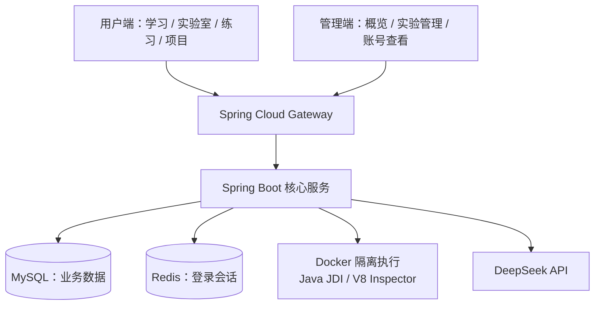
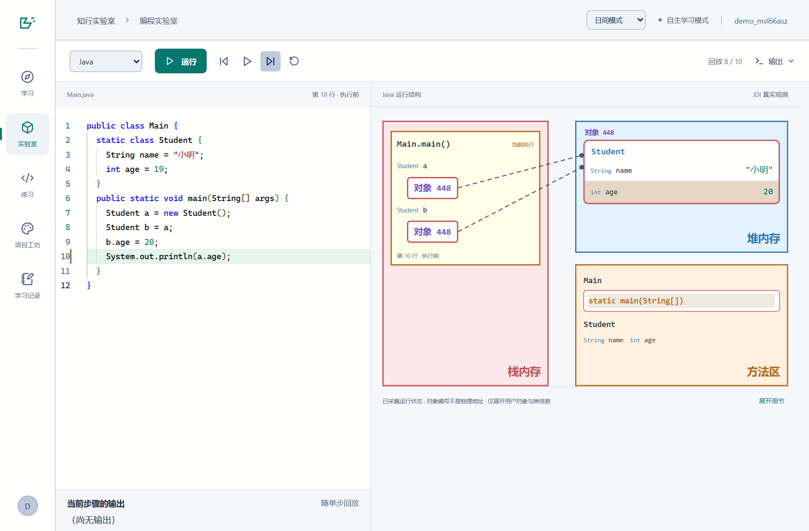
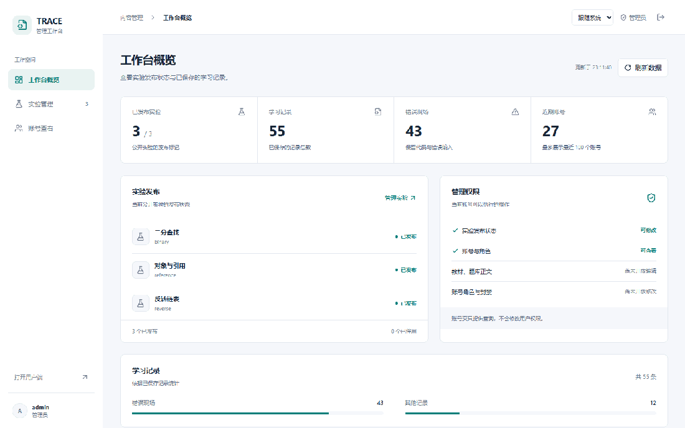

# TRACE · 知行实验室

基于 Vue 与 Java 的交互式编程学习平台。

## 架构

用户端和管理端共用 Vue 前端，由 Spring Security 校验身份与权限。



## 技术栈

| 部分 | 技术 |
| --- | --- |
| 前端 | Vue 3、TypeScript、Vite、Pinia、Vue Router |
| 编辑器与图形 | Monaco Editor、SVG、Canvas |
| 后端 | Java 21、Maven、Spring Boot 3、Spring Security |
| 数据与会话 | MyBatis、MySQL、Flyway、Redis、Spring Session |
| 网关 | Spring Cloud Gateway |
| 代码执行与追踪 | Docker、Java JDI、Node.js V8 Inspector |
| AI 教练 | DeepSeek API |
| 测试 | Vitest、JUnit、Playwright |

## 演示

### 用户端

Java、JavaScript 与 Vue 学习、单步内存可视化、知识点练习、AI 教练、学习记录与互动项目。



### 管理端

工作台概览、实验搜索与发布管理、账号和角色查询。



## 本地运行

### 1. 环境要求

以下启动方式适用于 Windows PowerShell。

| 环境 | 要求与用途 |
| --- | --- |
| JDK | 21 或以上，编译和运行 Java 后端 |
| Node.js、npm | Node.js 22.12 或以上的 22.x 版本，安装和运行前端 |
| MySQL | 8.0 或以上，保存业务数据；安装时包含命令行客户端 |
| Docker Desktop | 使用 Linux 容器，运行 Redis 和隔离代码执行环境 |

确保 `java`、`node`、`npm`、`mysql`、`docker` 命令可用。Maven 由项目自带的 Maven Wrapper 下载。

### 2. 本地配置

在项目根目录创建 `.env`，按本机环境修改数据库密码和管理员密码：

```dotenv
DB_USER=root
DB_PASSWORD=your_mysql_password
REDIS_PORT=6388

ADMIN_PASSWORD=your_admin_password
RUNNER_ENABLED=true

DEEPSEEK_API_KEY=
```

MySQL 默认连接本机 `3306` 端口的 `trace_coach` 数据库。可通过 `DB_URL` 修改连接地址和数据库名；使用其他数据库名时，需要同步修改 `scripts/Init-Database.ps1` 中的名称。

`REDIS_PORT` 应与本机 Redis 的实际连接端口一致。`6388` 可以更换，Docker 命令中的端口映射也要同步调整。

`ADMIN_PASSWORD` 用于首次创建管理员账号。AI 教练需要填写自己的 DeepSeek API Key；留空时，其余功能仍可使用。

### 3. 准备服务

启动本机 MySQL 和 Docker Desktop，然后执行：

```powershell
docker run -d --name trace-redis `
  -p 127.0.0.1:6388:6379 `
  redis:7-alpine

docker pull eclipse-temurin:21-jdk-alpine
docker pull node:22-alpine
```

Redis 容器创建后，后续使用下面的命令启动：

```powershell
docker start trace-redis
```

初始化数据库：

```powershell
powershell -ExecutionPolicy Bypass -File .\scripts\Init-Database.ps1
```

数据库表由 Flyway 在后端首次启动时自动创建。

### 4. 构建并启动

首次运行：

```powershell
powershell -ExecutionPolicy Bypass -File .\scripts\Start-Local.ps1 -Build
```

首次准备和构建需要下载 Maven、前后端依赖和 Docker 镜像，请等待命令完成。

用户可在页面注册账号。管理员用户名为 `admin`，密码为 `.env` 中设置的 `ADMIN_PASSWORD`。

后续启动：

```powershell
powershell -ExecutionPolicy Bypass -File .\scripts\Start-Local.ps1
```

修改源码后，重新使用带 `-Build` 的命令。

### 5. 停止应用

```powershell
powershell -ExecutionPolicy Bypass -File .\scripts\Stop-Local.ps1
```

该命令停止前后端进程。MySQL、Redis 和 Docker Desktop 按需单独关闭。运行日志位于 `runtime/` 目录。

### 常见问题

| 问题 | 检查方式 |
| --- | --- |
| 数据库连接失败 | 检查 MySQL 是否启动，以及 `.env` 中的账号密码 |
| 登录或会话异常 | 检查 Redis 是否启动，以及 `REDIS_PORT` 是否与实际端口一致 |
| Java、JavaScript 无法执行 | 检查 Docker Desktop、两个执行镜像和 `RUNNER_ENABLED=true` |
| AI 教练不可用 | 检查自己的 API Key 是否有效，以及服务是否可用 |
| 提示端口占用 | 检查 `5190`、`8090`、`8091` 是否被其他程序使用 |
| 依赖或镜像下载失败 | 检查网络是否能访问 Maven、npm 和 Docker 镜像源 |
